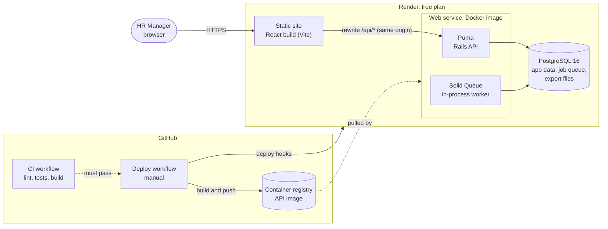
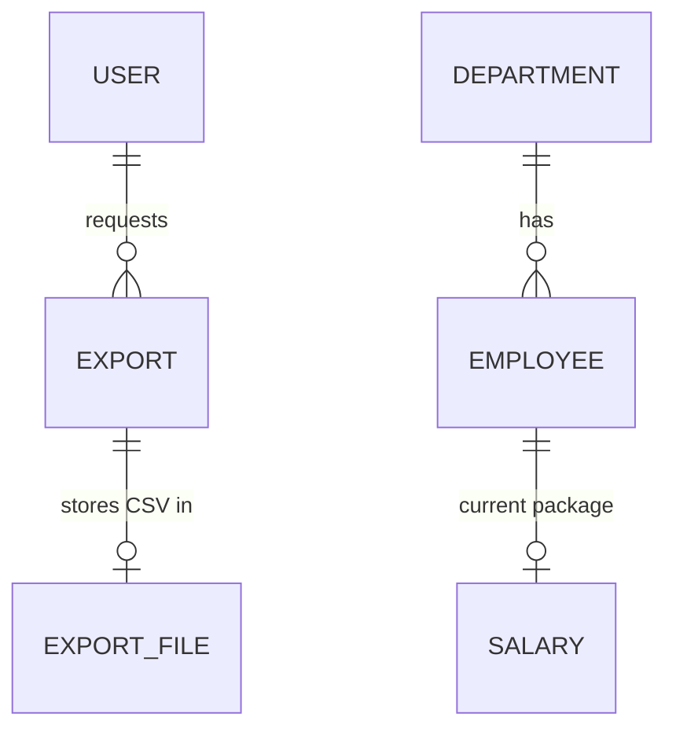
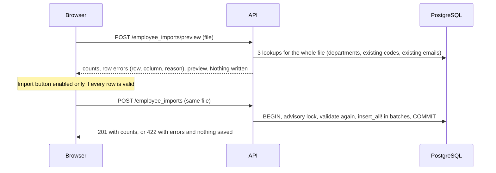

# Architecture

One repository holds a Rails 8.1 API (repository root) and a React app (`app/javascript/src`), built and
deployed as two Render services that share one PostgreSQL database.

## System

- **Same origin:** the static site rewrites `/api/*` to the API, so the session cookie is first-party and
  the browser never talks to the API host directly.
- **No separate worker:** Solid Queue runs inside Puma (`plugin :solid_queue`, async mode) and stores
  its queue in the same PostgreSQL database.
- **Start-up:** `bin/migrate-and-start` runs migrations, provisions the HR account from environment
  variables, optionally tops up demo employees (`SEED_DEMO_EMPLOYEES`), then starts Puma. Render's free
  plan has no pre-deploy step, so this is safe only with one instance.
- **Deploys** are manual (Actions → Deploy). The workflow refuses to run unless CI passed for that commit,
  then waits until the health checks report the new commit.

**Backend layers:** thin controllers → Pundit policy → service object (`app/services/<resource>/`) →
Jbuilder view. Errors are mapped to JSON in one place (`ApiRescuable`).
**Frontend:** pages under `components/`; all API calls go through React Query hooks
(`hooks/reactQuery/`) and `apis/`; routes, constants and translations are centralised.

## Data model

| Model        | Purpose                 | Key rules                                                                                                                                                  |
| ------------ | ----------------------- | ---------------------------------------------------------------------------------------------------------------------------------------------------------- |
| `User`       | The HR Manager          | `has_secure_password` (minimum 12 characters); single `hr` role; unique email                                                                              |
| `Employee`   | Identity and employment | UUID id; `INC-YYYY-NNNNNN` code from a Postgres sequence; unique email; ISO country code; status `active` / `notice_period` / `inactive` with notice dates |
| `Salary`     | Current compensation    | One per employee (unique index); `decimal(15,2)` CTC, base, PF, other components (≥ 0); currency; effective date                                           |
| `Department` | Grouping                | Unique name ignoring case; can't be deleted while it has employees                                                                                         |
| `Export`     | One CSV export request  | Owner, filters (JSON), status, progress counters; kept for 24 hours                                                                                        |
| `ExportFile` | The generated CSV       | Binary content in PostgreSQL, deleted with its export                                                                                                      |

Database constraints back the important rules: unique code, email and salary-per-employee indexes, check
constraints on status and non-negative amounts, and foreign keys.

## CSV import

The import is synchronous, stores nothing between the two steps, and is detailed in
[csv-import.md](csv-import.md).

## CSV export

1. `POST /api/exports` with the current list filters cancels the user's running export, saves an `Export`
   and enqueues `Exports::GenerateJob`. The response is `202`.
2. The job resolves the matching employee IDs with the same `FilterService` as the list, then writes the CSV
   to a tempfile in batches of 500. It updates progress after each batch and stops if cancelled.
3. The CSV is stored as an `ExportFile`. The browser polls `GET /api/exports` once a second while any
   export is active. It shows progress in a toast and downloads the file automatically in the tab that
   started it.
4. `GET /api/exports/:id/download` serves the file only to its owner and only within 24 hours.
   An hourly recurring job deletes expired exports and leftover tempfiles.

## Authentication and authorization

| Boundary        | Mechanism                                                                                                                                                        |
| --------------- | ---------------------------------------------------------------------------------------------------------------------------------------------------------------- |
| Public          | Only `POST /api/session` (sign in) and the health checks. There is no sign-up                                                                                    |
| Session         | Encrypted cookie: HttpOnly, `SameSite=Lax`, `Secure` in production, 12-hour absolute lifetime checked on the server. Sign-in is limited to 5 attempts per minute |
| Every other API | `authenticate_user!` runs before every action                                                                                                                    |
| Authorization   | Pundit on every action; policies deny by default and allow the `hr` role. Exports are scoped to their owner. A missing `authorize` raises an error               |
| Request forgery | Non-GET requests must be same-origin (`Sec-Fetch-Site`) and JSON. Only the import endpoints also accept file uploads                                             |
| Secrets         | HR credentials come from environment variables; nothing secret is in the repository or in `VITE_*` (frontend) variables                                          |

## Known limitations

- **Expired notice periods** become inactive when the employee list, dashboard, departments or pay pages
  are loaded, not by a scheduled job. An export started before any of those pages is visited could still
  show such employees as on notice.
- **Login rate limit:** it is counted in the API process's memory and per client IP. Behind Render's
  proxy, the IP may be the proxy's.
- **Export files** live in PostgreSQL rather than object storage. That's fine at this size, and they are
  deleted after 24 hours.
- **Single instance:** migrations at start-up, the in-memory rate limit and the in-process job worker all
  assume one API instance.
