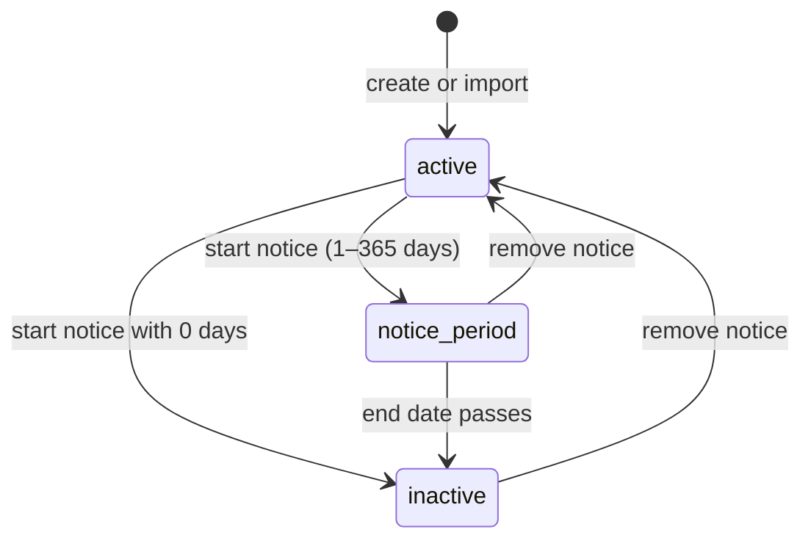

# Technical decisions

The decisions that shaped the product, with their trade-offs. See [02-architecture.md](02-architecture.md) for
how the pieces fit together.

## 1. CSV for import and export

- **Why CSV:** HR's data lives in Excel today, and Excel reads and writes CSV natively. CSV keeps the
  migration path simple (save as "CSV UTF-8", upload) with no spreadsheet-parsing dependency, and an
  explicit column contract that is easy to validate and document.
- **Import** moves the existing spreadsheets in. One template, header names that are checked, rows validated
  against the same model rules as the form.
- **Export** gives HR the filtered list (e.g. one country, as the brief asks) with salaries for offline
  work or sharing, without a reporting module.
- **Trade-off:** no `.xlsx` support. Exported files use readable headers and extra columns, so an export
  can't be imported back as it is.

## 2. No salary history, no payroll

- **Salary history:** each employee has one current `Salary` (unique index). This matches the spreadsheet
  being replaced. History would need effective-dated records, change auditing and its own UI, which is
  more than a two-day MVP justifies.
- **Payroll:** the app records what HR enters. It never calculates pay, payslips or tax, and it does not
  derive CTC from its components. CTC and the components are stored independently.
- **Hard delete:** employees are never deleted (see the next decision), so past headcount and exports stay
  consistent.

## 3. Notice periods and inactivation

- Starting a notice period records `notice_period_started_at` and `notice_period_ends_at`. The default
  length is 30 days (`NOTICE_PERIOD_DAYS`), and HR can choose 0–365 per employee.
- **Inactive is the soft delete.** Inactive employees stay listed under the Inactive filter, are read-only,
  and are left out of headcount and pay figures.
- **Expiry is applied when data is read:** `ExpireNoticePeriodsService` runs one `UPDATE` before the list,
  dashboard, departments and pay endpoints. It avoids a scheduler, but data not read through those
  endpoints (e.g. an export started first) can briefly lag.
- The "notice ends within N days" filter and the dashboard's upcoming departures share one scope
  (`Employee.leaving_within`), so their numbers always agree.

## 4. Currencies

- **Country decides currency.** Employees store an ISO 3166 country code. The salary's currency is always
  set from that country through the `countries` gem (`Employee::COUNTRIES`). The client can't override it,
  and the import checks the file's `currency` column against it.
- **No exchange rates.** Payroll converts at payment time, and stale rates would make figures wrong.
  Amounts are therefore never added up or compared across currencies.
- **Pay analysis is per country.** The Pay page shows median, average, lowest and highest CTC per country,
  and per department within a country, always in that country's currency. Org-wide salary averages were
  deliberately dropped.
- Money is `decimal(15,2)` end to end, and the UI formats it with `Intl.NumberFormat` and the explicit
  currency.

## 5. CSV import: validation, duplicates, transactions

| Concern            | How it works                                                                                                                                                                                                               |
| ------------------ | -------------------------------------------------------------------------------------------------------------------------------------------------------------------------------------------------------------------------- |
| File checks        | `.csv` extension, size and row limits (5 MB and 10,000 rows by default, configurable), UTF-8 only (byte order mark allowed, NUL bytes rejected), every header exactly once in any order                                    |
| Row rules          | `Employee` and `Salary` model validations run in a custom `:import` validation context, plus import rules: existing department, known country, currency matching the country, status and date rules, plain decimal amounts |
| Duplicates         | Within the file: codes and emails (emails ignoring case) repeated in other rows are reported with those rows' numbers. Against the database: one query for codes and one for emails across the whole file                  |
| Preview            | Writes nothing. It returns every problem with its row number and column, so HR fixes the file once                                                                                                                         |
| Confirm            | One transaction: advisory lock (imports run one at a time), validate again against current data, then `insert_all!` in batches of 1,000                                                                                    |
| All or nothing     | Any invalid row refuses the file. Any database error (unique index, check constraint, foreign key) rolls everything back                                                                                                   |
| Repeat submissions | Submitting the same file twice fails on the existing codes and emails, so it imports once                                                                                                                                  |
| Create-only        | Existing employees are never updated, and departments are never created by import, so a typo can't create a new department                                                                                                 |

**Trade-offs:** strict all-or-nothing means HR must remove rows that already exist rather than skip them.
The browser uploads the same file twice instead of the server storing it between the steps. That costs a
second upload, but there are no temporary files to secure or clean up.

## 6. Designing for 10,000 employees

| Area              | Approach                                                                                                                         |
| ----------------- | -------------------------------------------------------------------------------------------------------------------------------- |
| Lists             | Server-side pagination (25 per page, at most 100), filtering and sorting; indexes on status, country, department, code and email |
| Dashboard and Pay | Grouped SQL aggregates (`COUNT`, `AVG`, `percentile_cont` for the median), not per-employee loops                                |
| Import            | Lookups per file instead of per row; batched inserts; no records kept in memory after a row is checked                           |
| Export            | Background job, batches of 500 with eager-loaded departments and salaries, progress updates per batch                            |
| Seed              | 10,000 employees with salaries via batched `insert_all!`, codes reserved from the sequence in one query                          |

**Measured, on a development laptop only (not on Render):**

| Operation                               | Result                                          |
| --------------------------------------- | ----------------------------------------------- |
| Seed 10,000 employees                   | about 4 s                                       |
| Import 10,000 rows: check / confirm     | about 6–8 s / 8–10 s; about 120 MB extra memory |
| Export 10,000 employees                 | about 5 s, about 1.5 MB CSV                     |
| Pay summary over about 11,000 employees | about 30 ms                                     |

**Not verified:**

- Timings on Render's free plan (0.1 CPU, 512 MB RAM) are not measured. Imports are synchronous, so a
  10,000-row import there may take much longer than locally.
- If it's too slow, the next step is to move the confirm step into a Solid Queue job with progress, as
  exports already do.
- Search uses `ILIKE '%…%'` without a trigram index. That's fine at 10,000 rows, but it would need
  `pg_trgm` at a much larger scale.
- The production database was seeded with the 10,000 demo employees, but its load time wasn't measured.
