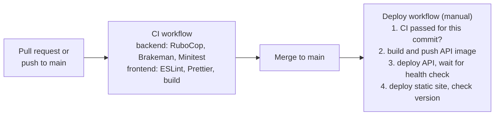

# Testing and deployment

## Commands

| Check            | Command                | Notes                                                              |
| ---------------- | ---------------------- | ------------------------------------------------------------------ |
| Backend tests    | `bin/rails test`       | Minitest + FactoryBot; needs PostgreSQL; runs in parallel          |
| Ruby lint        | `bin/rubocop`          | `rubocop-rails-omakase`                                            |
| Security scan    | `bin/brakeman`         |                                                                    |
| ESLint           | `npm run lint`         | Fails on any warning; also enforces i18n (no text literals in JSX) |
| Prettier         | `npm run format:check` |                                                                    |
| Production build | `npm run build`        |                                                                    |

Every UI feature was also checked end to end with scripted browser runs (Playwright, desktop and mobile
widths) against the running app, then by hand.

## Results

All checks pass on `main`, both locally and in CI:

| Check                  | Result                               |
| ---------------------- | ------------------------------------ |
| `bin/rails test`       | All tests pass: 0 failures, 0 errors |
| `bin/rubocop`          | No offenses                          |
| `bin/brakeman`         | No security warnings                 |
| `npm run lint`         | No problems                          |
| `npm run format:check` | All files formatted                  |
| `npm run build`        | Builds successfully                  |

The tests cover models, services, policies, jobs and every API controller: sign-in and sessions, employees
and notice periods, departments, dashboard, pay summary, exports, imports, settings and health checks.

## CSV import scenarios covered by tests

| Area          | Scenarios                                                                                                                                                                                                                                                                                              |
| ------------- | ------------------------------------------------------------------------------------------------------------------------------------------------------------------------------------------------------------------------------------------------------------------------------------------------------ |
| File          | Rejects non-`.csv`, non-UTF-8 (including UTF-16), malformed CSV, empty files, header-only files, oversize files and too many rows. Accepts any column order, header case and spacing, and a UTF-8 byte order mark. Keeps quoted commas and quotes. Skips blank lines and keeps spreadsheet row numbers |
| Headers       | Missing, duplicated and unexpected columns are reported                                                                                                                                                                                                                                                |
| Required data | Every value except the notice dates is required; rows with too few or too many values are reported                                                                                                                                                                                                     |
| Field rules   | Email format; name length; employee code length and the reserved `INC-` prefix; unknown departments (never created); unknown countries; currency must match the country; plain non-negative amounts with up to 2 decimals; unknown statuses; real `YYYY-MM-DD` dates                                   |
| Status dates  | Active: no notice dates. On notice: both dates, ending today or later, within 365 days. Inactive: both dates or neither, ending no later than today                                                                                                                                                    |
| Duplicates    | Codes and emails repeated within the file (emails ignoring case); codes and emails already in the database, checked with two queries for the whole file                                                                                                                                                |
| Persistence   | Creates each employee with one salary effective from the import date; imports nothing when any row is invalid; rolls everything back when a later batch fails; never changes existing employees; a repeated import creates nothing; currency matches the manual form                                   |
| API           | Template download; preview writes nothing; row and file errors; `201` on import, `422` with errors otherwise; file required; sign-in required; cross-site uploads rejected; other endpoints stay JSON-only                                                                                             |

## Seed data (10,000 employees)

| Question                  | Answer                                                                                                                                                                                                       |
| ------------------------- | ------------------------------------------------------------------------------------------------------------------------------------------------------------------------------------------------------------ |
| Does a seed script exist? | Yes: `Employees::SeedService`, run by `bin/rails db:seed` (development) or `bin/rails employees:seed_demo` (any environment, `COUNT` defaults to 10,000)                                                     |
| What does it create?      | 10,000 employees, each with one salary in the country's currency, across 10 countries and 8 departments (missing departments are created), with active, on-notice and inactive statuses and consistent dates |
| Is it safe to run again?  | Yes. It counts existing demo employees (email domain `seed.acme.test`) and only adds the missing ones                                                                                                        |
| Is it tested?             | Yes: `test/services/employees/seed_service_test.rb` (5 tests: count and validity, top-up, lifecycle dates, salary components, department reuse)                                                              |
| Has it been run?          | Locally: 10,000 employees in about 4 s, and a second run added 0. In production: seeded on start-up with `SEED_DEMO_EMPLOYEES=10000`, and the employees were confirmed in the live app after the deploy      |

## CI/CD

- **CI** (`.github/workflows/ci.yml`) runs on every pull request and every push to `main`, against PostgreSQL 16.
- **Deploy** (`.github/workflows/deploy.yml`) is started by hand (Actions → Deploy). It refuses to run
  unless CI passed for that commit. It builds the API image to GitHub Container Registry, triggers Render,
  and waits until `/api/health/live` and `/version.txt` report the new commit.
- **Hosting:** Render free plan. The [web app](https://incubyte-invoice-web.onrender.com) and the
  [API health check](https://incubyte-invoice-api.onrender.com/api/health/live) are both live.
- **Production** runs the latest `main`. After the deploy:
  - the API and the web app both report the deployed commit;
  - the database health check is ok;
  - every feature, including the Pay page, the "Notice ends" filter and the 10,000 seeded employees, was
    tested by hand in the live app.

## Performance for 10,000 employees

Design choices and local measurements are in [03-technical-decisions.md](03-technical-decisions.md#6-designing-for-10000-employees).
In short:

- Lists are paginated, filtered and sorted on the server, using indexes.
- The dashboard and Pay figures are grouped SQL aggregates.
- Imports check codes, emails and departments with one query each for the whole file, and insert in batches.
- Exports run in a background job, in batches.

Measured on a development machine: seed about 4 s; import check about 6–8 s and confirm about 8–10 s;
export about 5 s; pay summary about 30 ms.
